<div align="center">

# Isle

**A notch-style island for Windows.**

Audio with synced lyrics, a focus timer, reminders, a clipboard shelf, a
calendar, notifications, live resource usage, and an assistant that answers with
the AI you already have installed — living in a notch at the top of your screen.


</div>

Isle turns the centre of the top of the screen into a black notch. At rest it
shows what is going on — a song, a timer, a reminder — and pointing at it opens
it with spring physics into a small panel with a tab for each page. Passing over
it on the way elsewhere leaves it closed. Alerts for volume, battery, calendar
events and notifications appear in the same place instead of in the middle of
the screen.

Isle is a single native Windows binary: Rust drawing the island with Direct2D
into one layered window, no installer, no service, no background daemon and no
administrator prompt. Build it once and start it, and it is there until you
close it.

## Contents

- [Features](#features)
- [Requirements](#requirements)
- [Running it](#running-it)
- [Usage](#usage)
- [Settings](#settings)
- [The assistant](#the-assistant)
- [AI usage](#ai-usage)
- [Resource usage](#resource-usage)
- [Data & network](#data--network)
- [Troubleshooting](#troubleshooting)
- [Uninstalling](#uninstalling)
- [How it works](#how-it-works)
- [Support](#support)

## Features

<table>
<tr>
<td width="50%" valign="top">
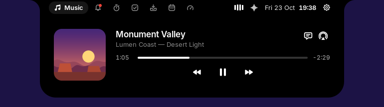<br>
<b>Audio.</b> Spotify, a browser tab, VLC or anything else that shows in the Windows media flyout: cover art with the playing app's own icon in the corner, a scrubber you can drag, transport controls and a volume slider that moves your real system volume.
</td>
<td width="50%" valign="top">
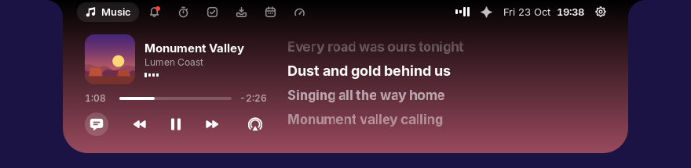<br>
<b>Synced lyrics</b> from <a href="https://lrclib.net">LRCLIB</a>: the line being sung large and bright, pauses as breathing dots. Click a line to jump to it.
</td>
</tr>
<tr>
<td width="50%" valign="top">
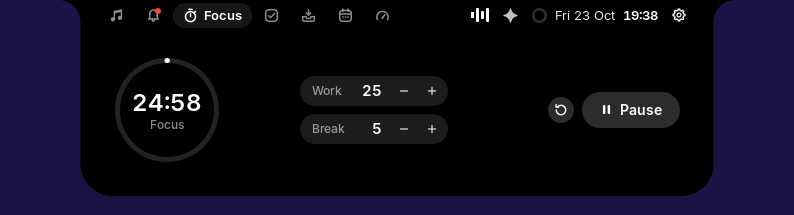<br>
<b>Focus.</b> A Pomodoro timer with breaks: a ring with the time left, the work and break lengths to change with − and +, and Start. Its ring and time stay in the closed notch.
</td>
<td width="50%" valign="top">
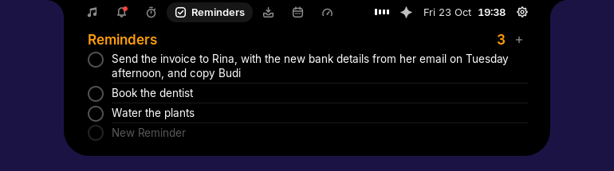<br>
<b>Reminders</b>, a plain list: add one, tick it off and it is struck through, then goes. A long one wraps over as many lines as it needs.
</td>
</tr>
<tr>
<td width="50%" valign="top">
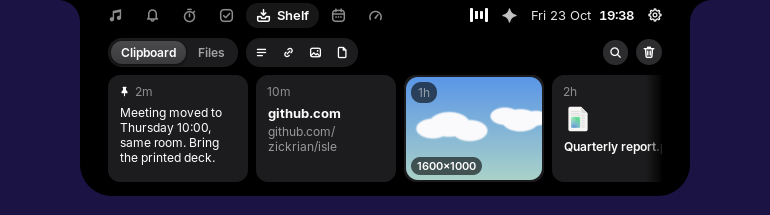<br>
<b>Clipboard history.</b> The text you copy, kept on this computer only, searchable and pinnable; click an entry to put it back on the clipboard.
</td>
<td width="50%" valign="top">
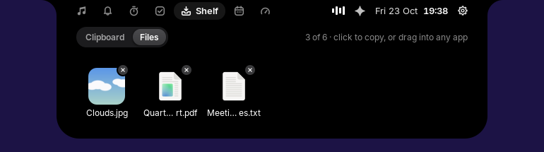<br>
<b>Files tray.</b> Drop files on the island and they wait here with their thumbnails; drag one into any app, or click it to copy it, ready to paste into a chat.
</td>
</tr>
<tr>
<td width="50%" valign="top">
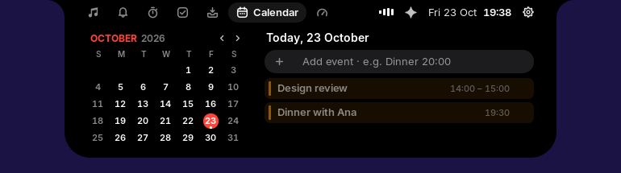<br>
<b>Calendar.</b> The month beside the chosen day's events. Add one in a line — "Dinner 8:00 pm" — and the notch reminds you before it starts.
</td>
<td width="50%" valign="top">
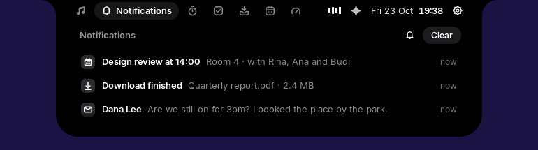<br>
<b>Notifications.</b> Windows notifications collect here as a plain list, newest first, and Clear dismisses them in Windows too, not only here. Windows asks once, the first time, whether Isle may read them.
</td>
</tr>
<tr>
<td width="50%" valign="top">
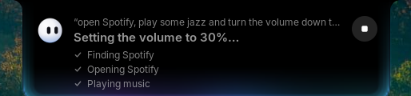<br>
<b>The assistant.</b> Ask it to play a song, install something, find a file, add a reminder or explain why the computer is slow. It answers with the AI you already use: Claude Code, Codex or Antigravity, chosen in Preferences.
</td>
<td width="50%" valign="top">
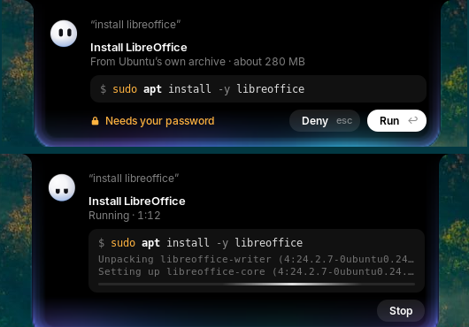<br>
<b>Installs and fixes things.</b> "Install VLC", "pasang codex": it shows the one command it wants to run, and what to know about it. Press <b>Run</b> or <b>Deny</b>. It runs in its own window while you carry on, and the card reports what it exited with.
</td>
</tr>
<tr>
<td width="50%" valign="top">
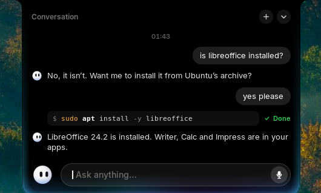<br>
<b>Talk it through.</b> Type your request and read the answer in the conversation; select text to copy it, + for a new one. The bot turns to the pointer, blinks, and changes expression as it thinks and answers.
</td>
<td width="50%" valign="top">
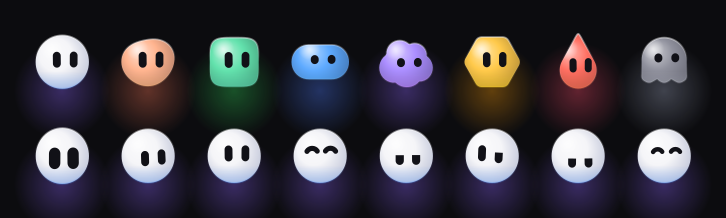<br>
<b>A bot of your own.</b> Eight shapes, from a circle to a cloud or a ghost, eleven colours or your own, softly shaded, and a glow round the island that matches it.
</td>
</tr>
<tr>
<td width="50%" valign="top">
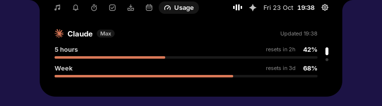<br>
<b>AI usage.</b> How much of your Claude plan's limits is used: a bar per limit it has (5 hours, the week) and when each resets. A warning comes as one nears its end.
</td>
<td width="50%" valign="top">
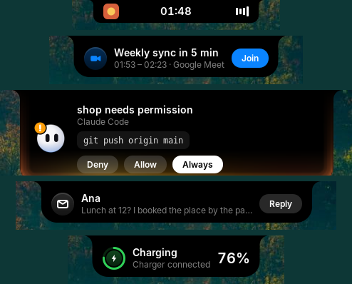<br>
<b>Alerts.</b> Volume changes, the battery, a calendar event, a notification: the notch grows to say it, then settles back to what it was showing.
</td>
</tr>
</table>

## Requirements

- **Windows 10 (1809 or newer) or Windows 11.**
- **Rust** (`cargo`), to build the binary. Install it from
  [rustup.rs](https://rustup.rs); the toolchain is the usual stable one.
- Nothing else to install. Not even administrator rights: the island runs as
  you, in your session.

The first run builds the native island and launches it. `run.bat` and `run.ps1`
handle this for you; you can also build it directly:

```powershell
cd isle-native
cargo build --release
.\target\release\isle.exe
```

## Running it

```powershell
.\run.bat                  # the usual way: builds if needed, starts above the screen
.\run.ps1                  # the same thing from PowerShell
.\run.ps1 -Build           # force a rebuild before starting
.\run.ps1 -Foreground      # keeps it in this window, so you see its errors
.\run.ps1 -Kill            # closes a running island
```

Only one island runs at a time: starting it again closes the one already there.
Nothing is added to startup or the registry — if you want it every day, put a
shortcut to `run.bat` in `shell:startup`.

## Usage

Point at the notch at the top centre of the screen. It opens with the page you
left it on, and the tabs along the top switch between Audio, Lyrics, Focus,
Reminders, Clipboard, Calendar, Notifications, the assistant and Usage. Point
away, and it closes; passing over it on the way to something else leaves it
closed.

On the Usage page, scroll over the panel (or click the dots) to move between
providers: Antigravity's limits, this computer's own resources, and Claude's
plan when you are signed in to Claude Code.

## Settings

The gear at the right of the open island opens Preferences: the assistant's
provider and model, the alerts the notch shows, and how it opens and closes. A
few rows on that page are carried over from Isle's own preferences and are not
wired to Windows yet.

## The assistant

Choose your assistant in Preferences — **Antigravity**, **Claude Code** or
**Codex** — and the model it should answer with. The command-line app has to be
installed and signed in on this PC (`agy`, `claude` or `codex` on your `PATH`);
if it is not, Isle says so instead of quietly answering with a different one.

Each request starts that app with your sentence, waits for the answer, and stops
it after three minutes. What comes back is drawn in the conversation. Where an
answer turns into an action — an install, a command — Isle shows the exact
command on a card and waits for **Run**; it runs in a separate PowerShell
process, and the card reports the exit code and the last lines it printed, with
**Stop** while it is going.

There is no speech input on Windows yet: type your request.

## AI usage

- **Claude Code** — read from Claude Code's own sign-in
  (`%USERPROFILE%\.claude\.credentials.json`) and its usage endpoint. The plan
  appears only when you are signed in.
- **Antigravity** — read from the transcripts of the sessions it has run on this
  computer.
- **System Resources** — always there: processor load, memory and the system
  drive, read from Windows each time the page is shown.

## Resource usage

The figures on the Usage page are real readings, not estimates: processor load
from `GetSystemTimes`, memory from `GlobalMemoryStatusEx`, storage from the
drive Windows itself is on. They are read at most once a second, and only while
the page is on screen.

## Data & network

Everything the island remembers is in `%APPDATA%\Isle`: settings, reminders,
calendar events, notifications, the clipboard history and the shelf. Cover art
and lyrics are held in memory and never written to disk.

The only things that go on the network are lyrics (LRCLIB), the cover art the
player itself points at, and the assistant you chose. Nothing else is sent.

## Troubleshooting

**Nothing appears.** Run `.\run.ps1 -Foreground` and watch the window: a
terminating error is caught inside its section, so the island normally keeps
drawing — but not if it fails before the window is built. A stale copy is
closed first; nothing else should be holding the notch.

**"Running scripts is disabled on this system."** Windows is refusing the file,
not Isle. Use `run.bat`, or add `-ExecutionPolicy Bypass` as shown above.

**The audio page says "There's no audio playing...."** Isle reads the Windows
media session, the same list the media keys use. If the player is not in that
flyout, it is not reporting itself to Windows and Isle cannot see it. Press a
media key once, or press play in the app, and it appears.

**The corner badge is empty.** That badge is the player's own icon, found from
the app id the player reports. A player that reports an id which matches neither
its executable nor an installed app leaves the corner empty.

**The assistant is not installed.** Isle looks for `agy`, `claude` or `codex` on
your `PATH`. Open a new console after installing one, then restart the island so
it picks up the new `PATH`.

**The island sits under a full-screen game.** Isle is a normal top-most window;
exclusive full-screen modes draw over it. Windowed borderless keeps it visible.

## Uninstalling

```powershell
.\run.ps1 -Kill
```

Then delete the folder you unzipped, and `%APPDATA%\Isle` if you also want its
settings and history gone. An older build kept its files in
`%USERPROFILE%\.config\isle`; that folder is left untouched, so delete it too if
it is there. Nothing was written anywhere else.

## How it works

The application is the `isle-native` crate, a single `isle.exe`. It owns one
layered window over the notch and repaints it from a timer, with the shape,
spring and pixel maths ported line-for-line from the original so the motion and
the bot's look match. The pieces it uses:

- **Direct2D / DirectWrite** for the window, the notch geometry, the spring
  physics and every glyph and icon (parsed from SVG and cached).
- **WinRT** (`Windows.Media.Control`, `Windows.UI.Notifications`) for the media
  session and for reading notifications.
- **Win32** for the layered-window present, the processor and memory readings,
  and the Windows audio endpoint behind the volume slider.